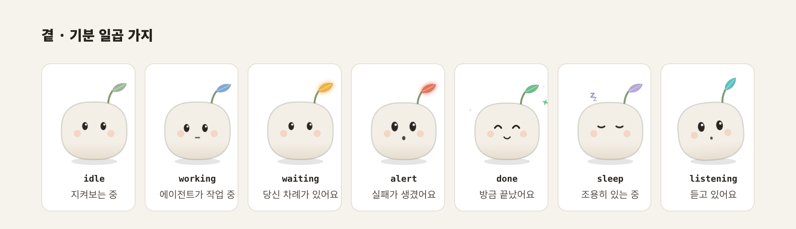
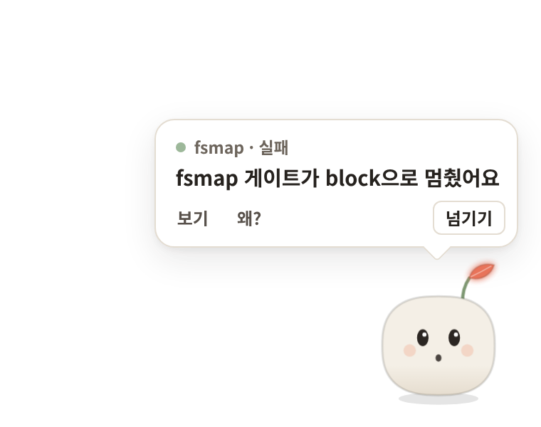
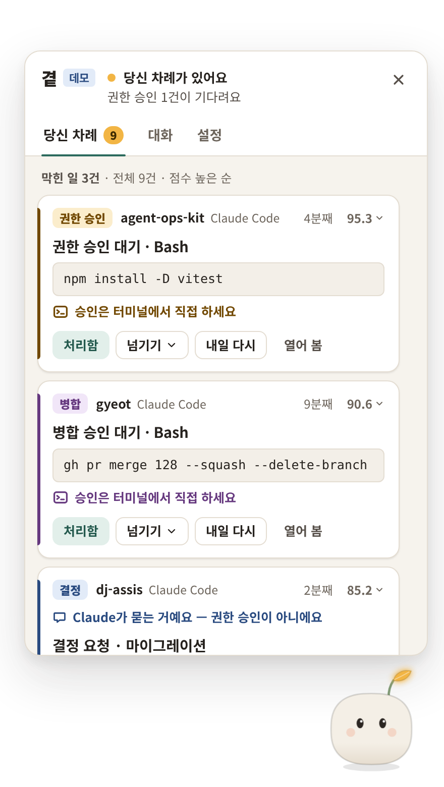

# 곁 (gyeot)

Claude Code·Codex 생태계 위에 얹는 **AI 동료 아바타**다. 여러 AI 세션이 사람을 기다리는 순간을 놓치지 않게 하면서, 그 대가로 집중을 깨지는 않는다. Windows 네이티브용이고, 데이터는 로컬에만 둔다.



- **듣는다**: Claude Code·Codex 훅, fsmap·AOK 하네스 로그를 한 흐름으로 모은다. 훅은 작업을 막거나 기다리게 하지 않는다.
- **판단한다**: AOK 관제실과 같은 이름·점수(승인 95, 결정 85, 실패 80…)로 "당신 차례"를 만든다. 숫자는 결정적인 규칙이 계산한다.
- **표정으로 먼저 알린다**: 새싹 색과 눈빛이 상태다. 말풍선은 예산 안에서만 쓰고, 기본 설정에서는 소리를 내지 않는다. 집중 모드와 "사람이 이미 그 세션에 있음"을 지키고, 모든 알림에 "왜?"가 붙는다.
- **대화를 잇는다**: 곁에게 한 말이 실행 중인 Claude Code 세션에 들어가고, Claude의 답은 곁이 읽어 준다. Claude는 곁을 통해 선택지 카드를 내밀 수 있다.
- **대신하지 않는다**: 권한 승인·병합·삭제는 언제나 터미널에서 사람이 한다. 학습 결과는 제안으로만 나오고, 곁은 스스로 설정을 바꾸지 않는다.

| 말풍선 | 당신 차례 패널 |
|---|---|
|  |  |

## 설치 (Windows)

1. **받기**: GitHub Actions의 최근 `CI` 실행에서 `gyeot-windows-x64` 산출물(zip)을 받아 푼다. 셸 설치본(`gyeot-shell-setup-x64.exe`)도 같은 곳에 있다. 직접 빌드하려면 아래 [개발](#개발)을 본다.
2. **설치**: 압축을 푼 폴더에서 아래 명령을 실행한다. 관리자 권한은 필요 없다.
   ```powershell
   powershell -ExecutionPolicy Bypass -File .\scripts\install.ps1 -DryRun   # 무엇을 할지 먼저 본다
   powershell -ExecutionPolicy Bypass -File .\scripts\install.ps1           # %LOCALAPPDATA%\gyeot\bin 에 설치, 설정 조각만 출력
   ```
   - `-ApplyClaudeHooks`: `~/.claude/settings.json`을 백업한 뒤 곁의 훅만 더한다. 기존 훅(fsmap·AOK·work-atlas 등)은 그대로 두고, 여러 번 실행해도 결과가 같다.
   - 기본 훅에는 `PostToolBatch`(도구 묶음이 끝날 때 한 번)가 들어 있다. 사람이 승인한 뒤 곁이 "아직 기다린다"고 오해하지 않게 하는 신호다. 빼려면 `-NoActivityHook`을 준다. 그러면 승인한 뒤에도 승인 카드가 턴이 끝날 때까지 남는다.
   - `-RegisterStartup`: 로그인할 때 데몬을 창 없이 띄운다.
   - 지울 때는 `scripts\uninstall.ps1`을 쓴다. 데이터는 `-PurgeData`를 줄 때만 지운다.
3. **띄우기**: `gyeot-shell`(투명 오버레이, 트레이, `Ctrl+Alt+Space`)을 실행한다. 셸 없이 쓰려면 `gyeotd --open`으로 브라우저에 연다(트레이 메뉴 "곁 열기"와 같다). 주소만 쳐서 열면 "열쇠가 없다"는 안내가 나온다. 얼굴 페이지는 토큰을 받지 않고, 이 명령이 만든 일회용 코드로 세션을 연다.

### Claude Code와 잇기

- **훅**: `-ApplyClaudeHooks`를 쓰거나, 설치 때 출력된 조각을 `~/.claude/settings.json`에 넣는다(견본: `examples/claude-settings.hooks.json`). exec 형식에 `async`라서 Git Bash·PowerShell을 거치지 않고, 세션을 기다리게 하지도 않는다.
- **대화(channel, 연구 프리뷰)**: `examples/mcp.json`처럼 `gyeot` MCP 서버를 등록한 뒤, 대화할 세션을 이렇게 시작한다.
  ```powershell
  claude --dangerously-load-development-channels server:gyeot
  ```
  처음 한 번 경고 화면과 MCP 서버 동의가 나온다. 이 플래그 없이 시작한 세션에는 곁의 말이 닿지 않는다(Claude Code가 조용히 버린다).
- **Codex(선택)**: `examples/codex-hooks.json`, `examples/codex-config.notify.toml`. Codex 페이로드 꼴은 아직 실측 전이다(F3·F4).
- **하네스 로그(선택)**: `examples/gyeot-config.toml`의 `[[tail]]`에 저장소별 `fsmap-harness/log.jsonl`·`aok-harness/log.jsonl`을 적는다.

## 쓰는 법

- 평소에는 아바타의 표정만 본다. 앰버 새싹은 "당신 차례", 코랄은 "실패", 블루는 "작업 중", 라벤더는 "집중 모드"다.
- 아바타를 누르면 패널이 열린다. **당신 차례**에서는 처리함·넘기기(이유: 과민·이미 처리·무관)·내일 다시·열어 봄을 쓰고, **대화**에서는 세션에 말을 걸고(`Win+H` 받아쓰기), **설정**에서는 집중 모드·소리·음성·제안을 다룬다.
- 승인 대기는 말풍선까지만 알리고 소리를 내지 않는다. 사람이 승인한 순간을 알려 주는 훅이 없어서, 승인한 빌드가 오래 돌면 곁이 아직 기다린다고 착각하기 때문이다. 소리로도 받고 싶으면 `%LOCALAPPDATA%\gyeot\config.toml`에 `approval_interrupt = true`를 적는다.
- 같은 종류를 자주 "과민"으로 넘기면 곁이 "앞으로 표정으로만 알릴까요?"라고 제안한다. 받아들일 때만 바뀌고, 설정에서 되돌릴 수 있다.

## 검증 상태

| 무엇 | 어디서 | 결과 |
|---|---|---|
| 코어·서버·데몬·훅 심 | Linux, `cargo test --workspace` | 263 통과. clippy `-D warnings` 0건(Linux·Windows 대상), wasm32 빌드 확인 |
| 얼굴 | Linux, vitest | 351 통과. 세션 열쇠·보내기 전 상대 확인·fetch SSE 해석기·401 처리, 결정 카드 안내, 색 대비 WCAG AA, 가짜 데몬(mock)의 보안 규칙 포함 |
| channel | Linux, vitest(묶은 파일을 실제로 띄움) | 53 통과. 데몬 확인(hello) 포함. Node 22 |
| 셸 | Linux(WebKitGTK), cargo test | 82 통과. IPC 권한(ACL)·데몬 확인·부트 흐름·데몬이 멈추면 바로 닫기 시험 포함. Windows 대상 clippy 0건 |
| 설치 스크립트 | pwsh 7.4 | 128 통과, Windows 전용 폴더 권한 시험 1개는 CI(Windows)에서 |
| **끝-끝(가짜 없음)** | Linux, `tests/e2e/e2e.mjs` | 64/64. 실제 데몬·훅 심·channel·얼굴(Chrome)을 이음. 세션 열쇠·데몬 확인·포트를 가로챈 가짜 서버(훅·`--open`·열린 얼굴 모두 열쇠 0건)·스풀 줄이기 포함 |
| Windows 빌드·시험·끝-끝·설치본 | GitHub Actions(windows-latest) | 이 판의 결과는 `docs/field-notes.md` |
| 독립 적대 검증 | 작업 맥락을 모르는 에이전트 | 여러 라운드(새 눈 3번·회귀 재검증 3번). 기록은 `docs/field-notes.md` |
| 실제 Claude Code 훅·channel, WebView2·음성, 클릭 통과 체감 | 사용자 Windows | **실측 전** — `docs/roadmap.md` F1–F12 |

변이 시험(고친 동작을 되돌리면 시험이 실패하는지)을 부품마다 돌렸다. 기록은 `docs/field-notes.md`에 있다.

## 구조

```
crates/gyeot-core     판단 코어: 정규화·마스킹·항목·존재감·전달·제안 (결정적, 시계 없음, wasm 호환)
crates/gyeot-server   로컬 서버: 127.0.0.1·Host/Origin/토큰 검사, SSE, 이벤트 소싱 로그, tail, 스풀
crates/gyeotd         상주 데몬 (gyeotd --init | --print-config)
crates/gyeot-hook     훅 심: stdin → 400ms 전송 → 실패 시 스풀, 늘 exit 0, stdout 없음
channel/              Claude Code channel(MCP): 곁 ↔ 실행 중인 세션 대화, 결정 카드
face/                 얼굴: Preact 웹 UI + 오리지널 SVG 아바타 (?mode=overlay, ?demo=…)
shell/                Tauri 2 셸: 투명 오버레이, 선택적 클릭 통과, 트레이, 전역 단축키
scripts/ examples/    설치·제거 스크립트, 설정 견본
tests/e2e/            끝-끝 실측
docs/                 개념·아키텍처·계약·결정·연동·로드맵·실측 기록·아바타 규격
```

## 문서

- [개념](docs/concept.md): 왜 만드나, 계승한 원칙, 목표·비목표·안티골, 성공 지표
- [아키텍처](docs/architecture.md): 층 구조, 데이터 흐름, 보안 모델, 저장
- [계약](docs/contracts.md): 부품 사이의 정본 규격
- [결정 기록](docs/decisions.md): 결정, 근거, 버린 대안
- [연동](docs/integrations.md): Claude Code·Codex·하네스·AOK 관제실·dj-assis
- [로드맵](docs/roadmap.md): 실측할 것(F 목록), 다음 판, 시드
- [아바타 규격](docs/avatar-spec.md)

## 개발

```bash
cargo test --workspace                       # Rust 전체
(cd face && npm ci && npm test && npm run build)
(cd channel && npm ci && npm test && npm run build)
cargo build --workspace && node tests/e2e/e2e.mjs --screenshots /tmp/shots
cargo run -p gyeotd                          # http://127.0.0.1:47321 (얼굴은 face/dist)
(cd face && npm run dev)                     # 얼굴만 따로: ?demo=panel, npm run mock
```

작업 규칙은 [CLAUDE.md](CLAUDE.md)에 있다.
